# 运营平台-类目管理-拆页迭代

# 一、需求背景

cibo 类目和电商类目分成两页，映射单独做，不和类目编辑耦在一起，映射维护放在 cibo 类目管理，不另做第三页，也不在电商类目里改

商品落类、属性模版仍走电商三级类目，cibo 只负责和电商类目对上，属性从模版里拆出来，按类目属性、销售属性、基础属性单独管理

商品类型和属性不是一回事，属性描述商品参数，商品类型决定怎么卖、怎么履约，普通商品和虚拟商品履约方式不同

1. 类目分两页，映射只在 cibo 页维护

一条 cibo 三级类目选择关联哪一条电商三级类目，在 cibo 页的编辑里完成，电商类目页只读展示已关联 cibo 类目，编辑弹窗里该字段置灰，不能改，改电商类目的名称、标签、医疗器械，不会改到映射

2. 模版和属性拆开

属性在属性管理里新建、编辑，分三类：类目属性、销售属性、基础属性，模版只回答这个电商类目用哪些属性，新建时选择所属电商类目，再从属性库关联，不再在模版里配置输入形式、属性值、是否必填，暂无对应类目时，所属类目选【无归属】

3. 商品类型

普通商品：履约方式为物流发货，需收货地址，走仓储出库，售卖方式为正常售卖，可单独购买，不是赠品

虚拟商品：履约方式为自动发放，无需收货地址，支付后由系统发放，售卖方式为正常售卖，可单独购买，不是赠品

赠品：履约方式为随主商品，不单独履约，售卖方式为仅随单赠送，不可单独购买，是否赠品为是

售卖方式另有预售，预售仍可单独购买，不是赠品，履约方式按普通商品或虚拟商品各自选择，不另算一种履约

# 二、需求明细

|页面|修改项|详细描述|图示|
|---|---|---|---|
|cibo类目管理|主页面|1. 独立页面，左侧为 cibo 三级类目树，树上方：类目名称搜索、展开、收起、导出全部 2. 右侧基本信息：类目名称、类目编码、备注、关联电商类目，关联电商类目展示路径，如「运动/户外-户外装备-望远镜」 3. 本页不展示属性模版，不维护标签、医疗器械|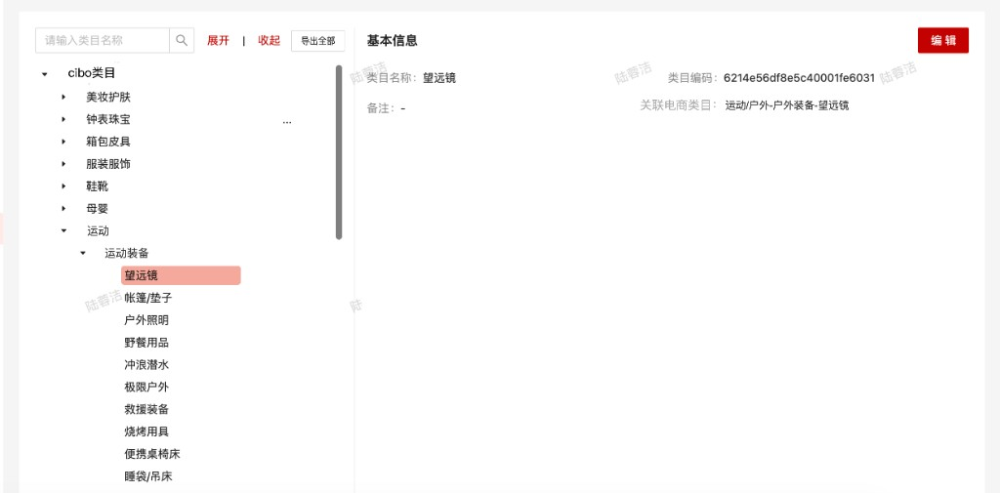|
||编辑|1. 类目编码置灰 2. 类目名称必填，最多 60 字 3. 备注 4. 关联电商类目：下拉，枚举为电商三级类目，映射只在这里改 5. 不放标签、医疗器械、属性模版|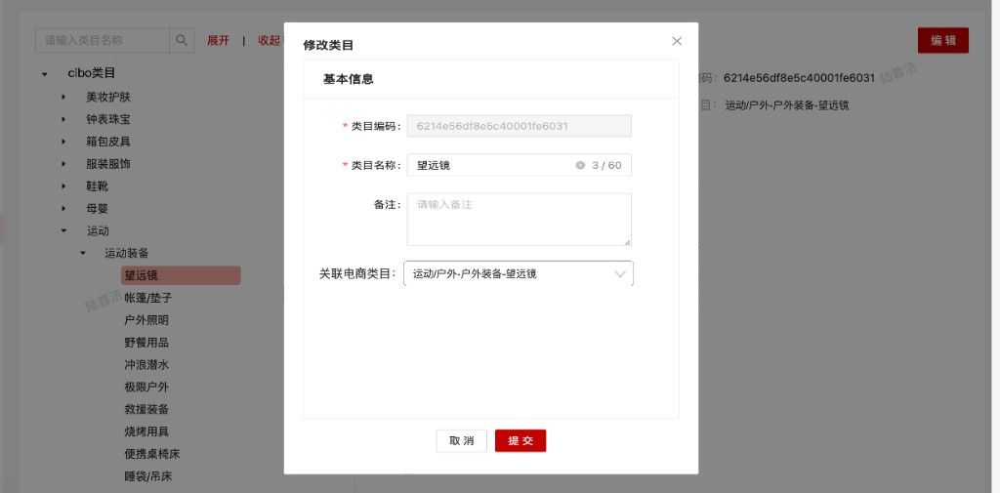|
|电商类目（后台类目）|主页面|1. 左侧仍为平台后台类目树 2. 基本信息保留：类目名称、类目编码、备注、标签、是否有医疗器械商品 3. 新增只读项「已关联 cibo 类目」，由 cibo 页的映射反显，本页不可改 4. 已关联属性列表：列保留模版 ID、模版名称、模版编码，去掉模版别名和操作，不在本页做「关联模版」|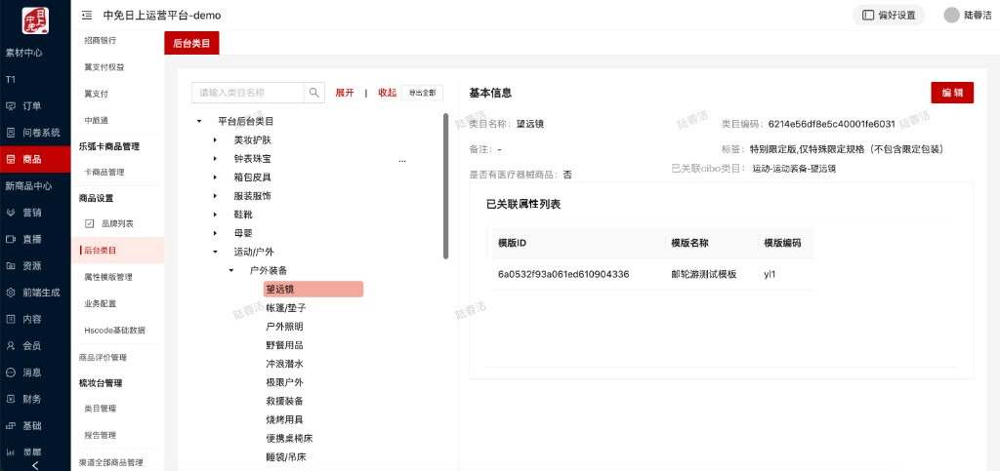|
||编辑|1. 类目编码置灰 2. 已关联 cibo 类目：置灰展示，不可下拉、不可清空，要改映射，回到 cibo 类目管理 3. 类目名称、备注、标签、是否有医疗器械商品：仍在本弹窗维护|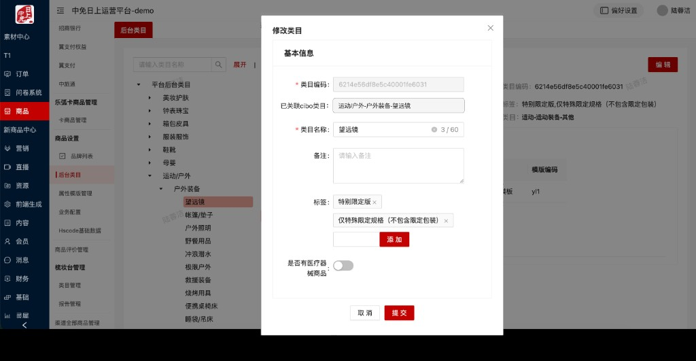|
|模版管理|筛选|所属电商类目、模版名称、模版编码、模版 ID|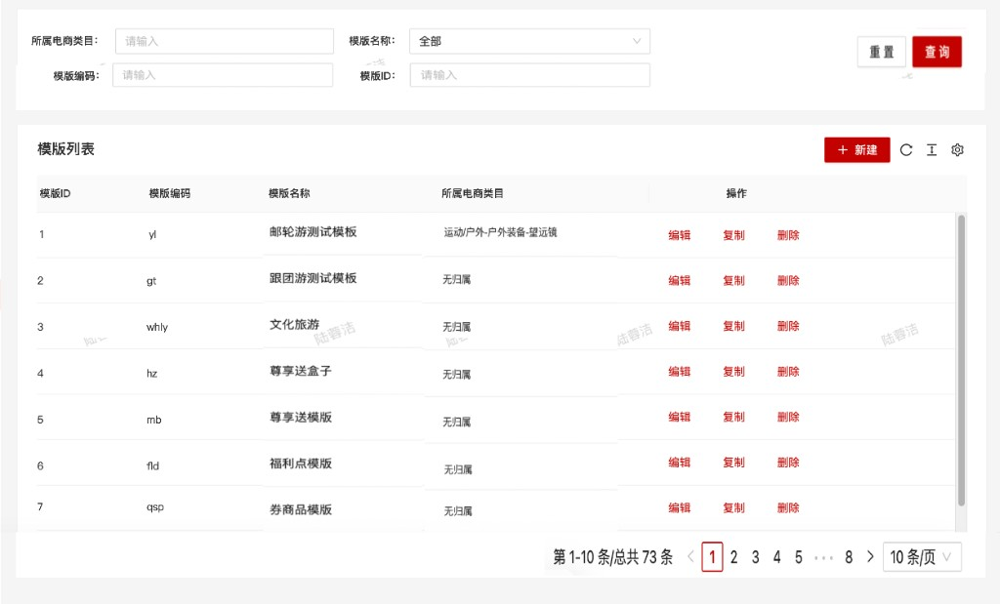|
||列表|列：模版 ID、模版编码、模版名称、所属电商类目、操作（编辑、复制、删除），所属电商类目在新建、编辑时选择，反显到列表，未选具体类目时显示「无归属」| |
||新建&编辑|1. 模版 ID：置灰 2. 模版名称：必填，不可重复，最多 20 字 3. 模版编码：必填，最多 36 字 4. 所属电商类目：必填，下拉，枚举为电商三级类目 +【无归属】 5. 备注：最多 200 字 6. 属性关联列表：按类目属性、销售属性、基础属性分 Tab，列：属性 ID、属性名称、前端显示名称、操作（移除），移除只解除本模版的关联，不删属性库 7. 【关联属性】打开选择弹窗，从属性库勾选后确定 8. 模版配置保留：商详页标题拼接、商详页参数展示|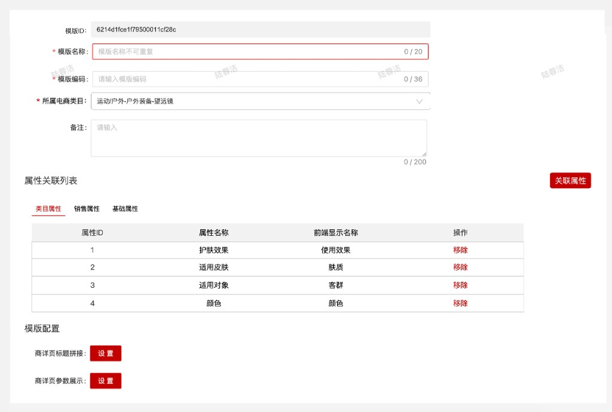|
||关联属性|1. 筛选：属性 ID、属性名称、前端显示名称 2. Tab 与属性库一致：类目属性、销售属性、基础属性 3. 多选，列：属性 ID、属性名称、前端显示名称、属性值，已选项可取消 4. 确定后回到模版的属性关联列表|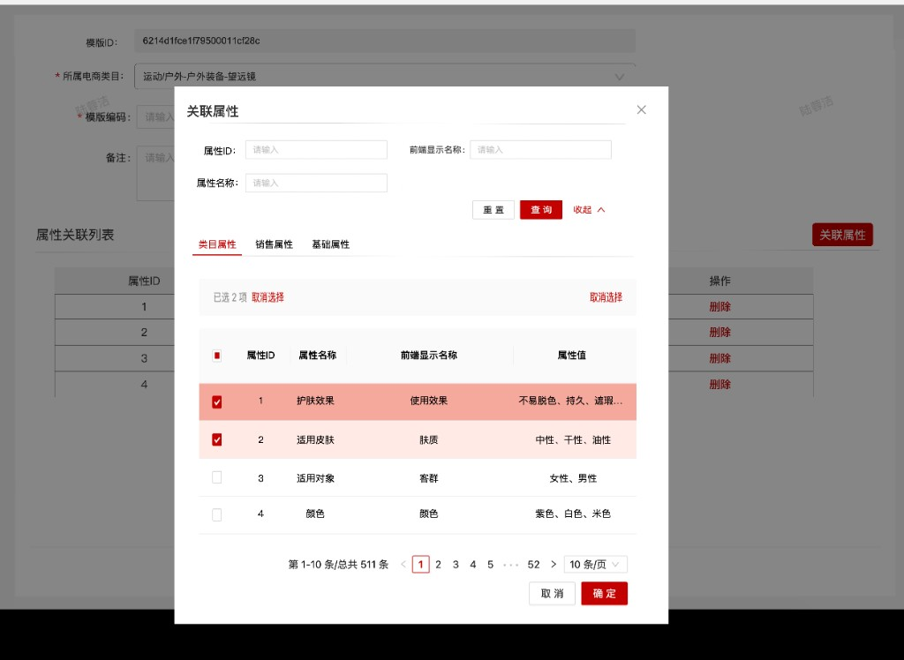|
|属性管理|主页面|1. 独立页面，不在模版里维护属性定义 2. 筛选：属性名称、属性 ID、前端显示名称 3. Tab：类目属性、销售属性、基础属性 4. 列：属性 ID、属性名称、前端显示名称、输入形式、属性值、输入限制、页面必填、允许自定义属性值、控件提示文案、支持批量修改、是否可导出、排序、操作（编辑、移除）|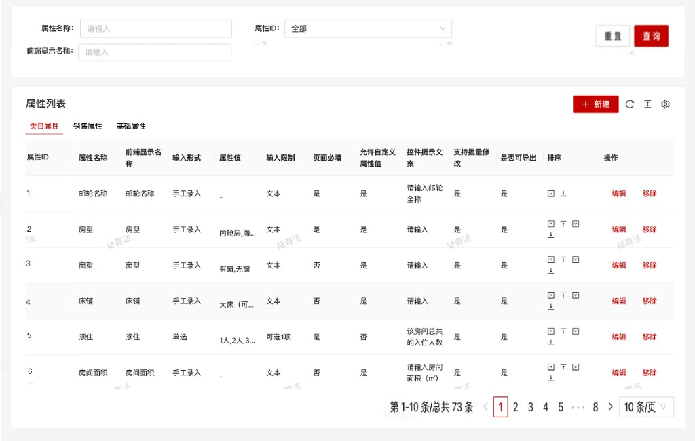|
||新建&编辑（类目属性、销售属性）|1. 属性名称、前端显示名称：必填，各最多 10 字 2. 属性类型：类目属性 / 销售属性 / 基础属性，类型决定出现在哪个 Tab 3. 输入形式：单选、多选、手工录入 4. 属性值：输入后添加，多选时输入限制为「最多可选 N 项」 5. 页面必填、允许自定义属性值、来自大数据、支持批量修改、是否可导出：是 / 否 6. 控件提示文案：最多 10 字|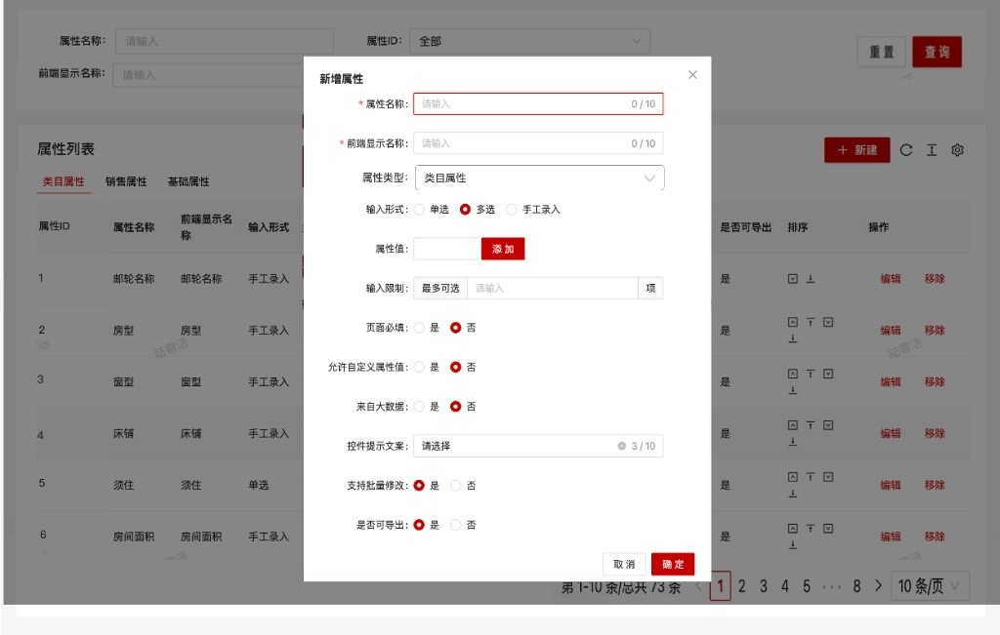|
||新建&编辑（基础属性）|1. 名称、前端显示名称、属性类型、页面必填、允许自定义、来自大数据、提示文案、批量修改、是否可导出：与上相同 2. 输入形式默认手工录入 3. 输入限制为枚举，如图片，选图片时增加：图片数量限制（不填默认 10 张）、素材库可选（是 / 否）|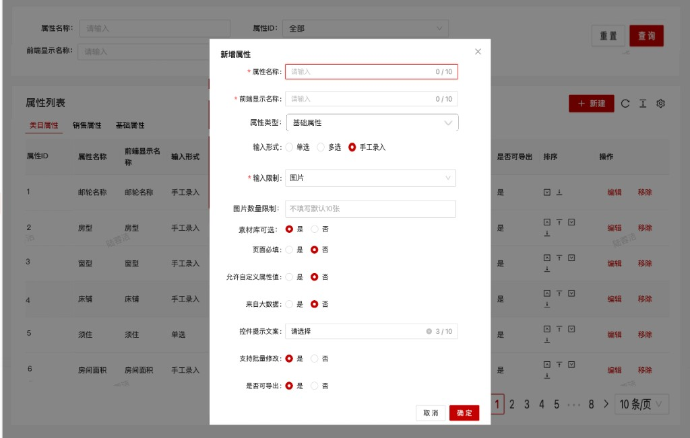|
|商品类型管理|筛选|1. 类型名称：输入框，占位「请输入」 2. 履约方式：下拉，默认全部，枚举为物流发货、自动发放、随主商品 3. 重置、查询|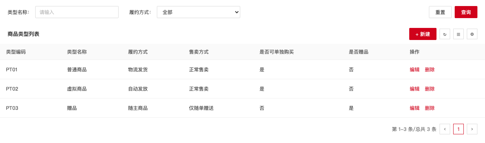|
||列表|1. 独立页面，不放进属性，也不挂在类目上 2. 列：类型编码、类型名称、履约方式、售卖方式、是否可单独购买、是否赠品、操作（编辑、删除） 3. 预置三条：普通商品 / 物流发货 / 正常售卖，虚拟商品 / 自动发放 / 正常售卖，赠品 / 随主商品 / 仅随单赠送| |
||新建&编辑|1. 类型名称：必填，最多 20 字 2. 类型编码：必填，不可重复 3. 履约方式：必填，下拉，物流发货 / 自动发放 / 随主商品 4. 售卖方式：必填，单选，正常售卖 / 仅随单赠送 / 预售 5. 是否可单独购买、是否赠品：选「仅随单赠送」时，是否可单独购买锁定为否，是否赠品锁定为是，其余售卖方式下是否赠品为否，可单独购买默认为是 6. 普通商品选物流发货，虚拟商品选自动发放，赠品选随主商品|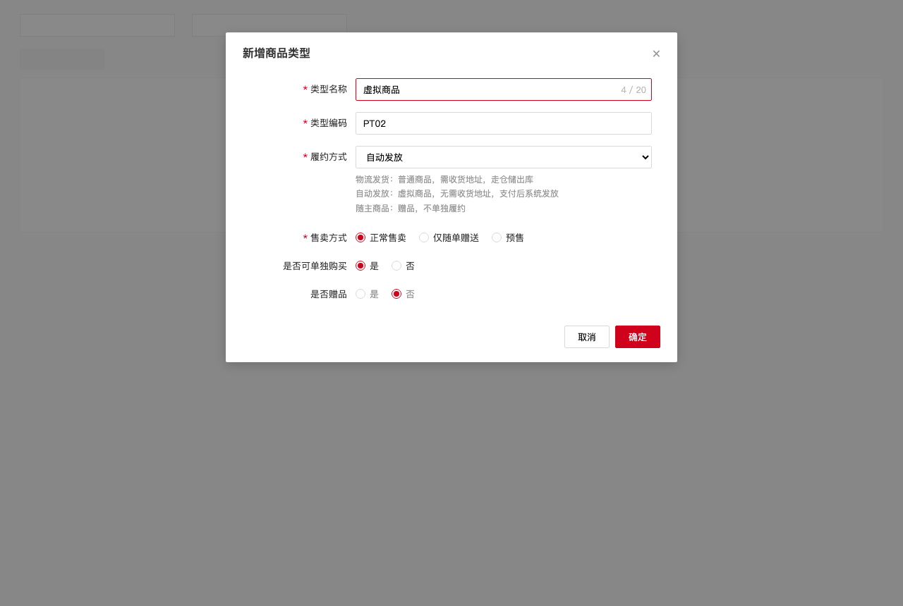|
